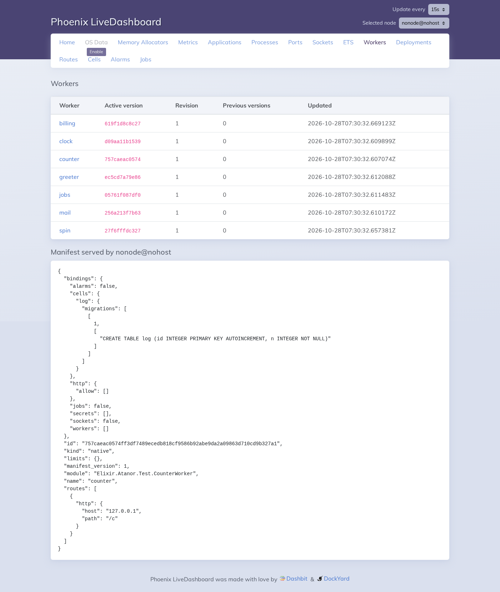
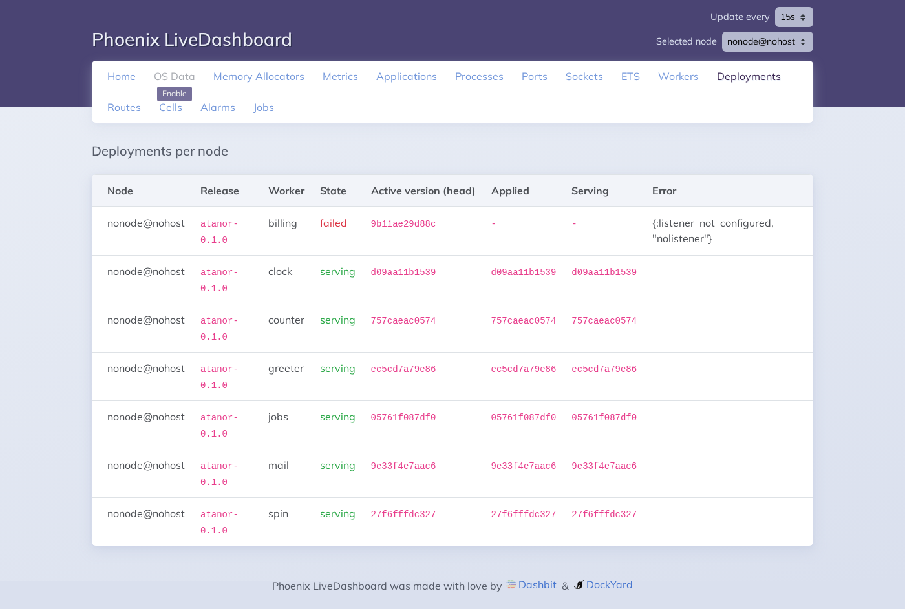
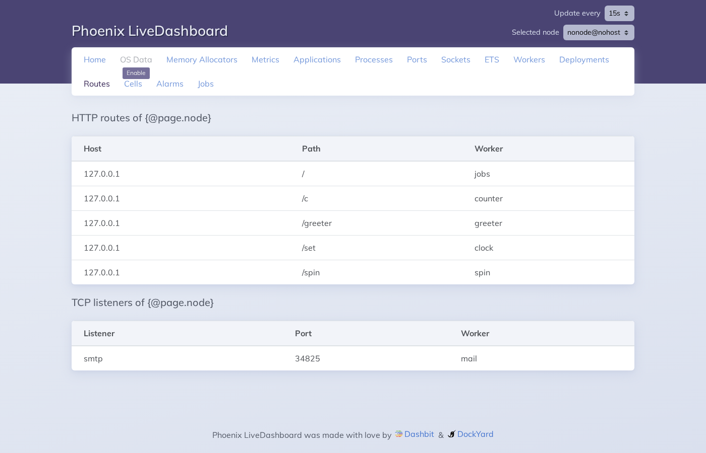
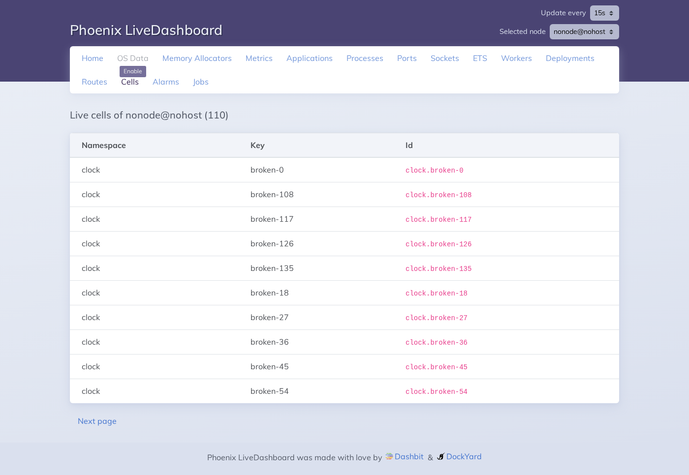
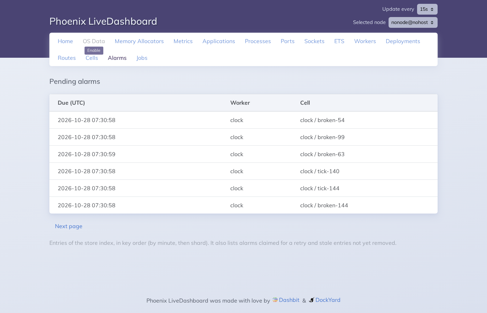
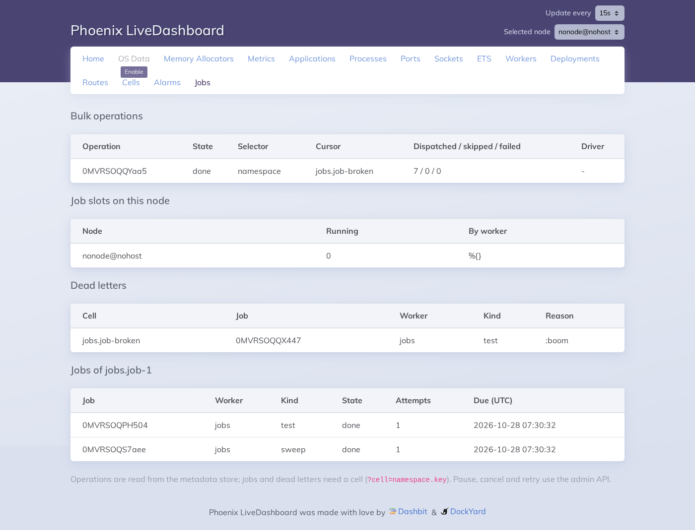
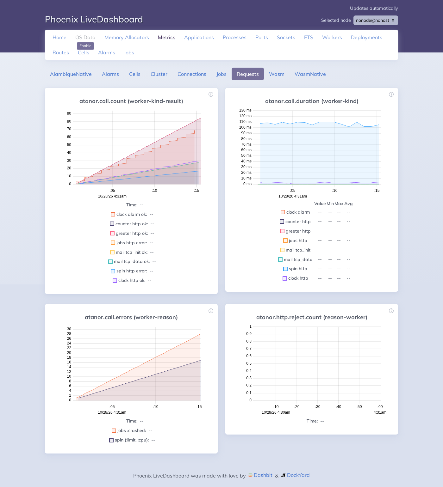
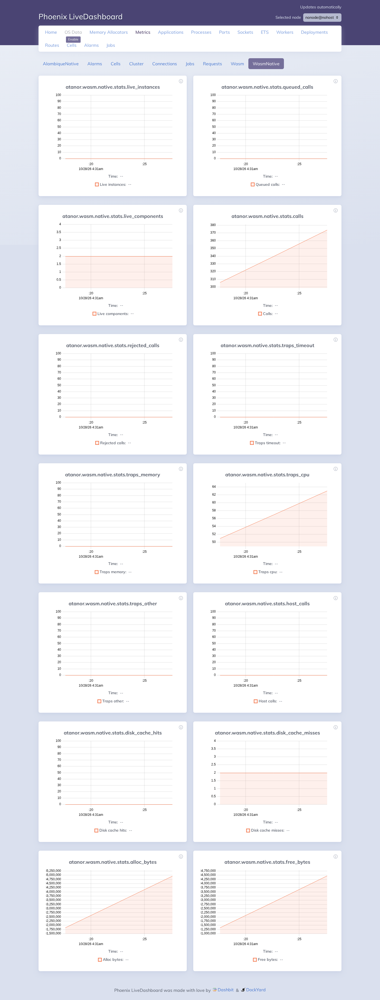

# Dashboard screens

The dashboard is a Phoenix LiveDashboard with six pages of Atanor's and its
Metrics page. It is read-only. To open it, see
[how-to-open-the-dashboard.md](how-to-open-the-dashboard.md). The other menu
entries (Home, OS Data, Memory Allocators, Applications, Processes, Ports,
Sockets, ETS) are LiveDashboard's own and describe the BEAM node.

The images come from a node with synthetic workers, cells, alarms, jobs and traffic.
`mise run docs:dashboard-screenshots` regenerates them: it runs
`scripts/dashboard-demo.exs` (a node over the test workers, with background
traffic) and captures each page with Playwright through
`scripts/capture-dashboard.cjs`.

The menu is the same on every page. **Selected node** (top right) picks the node
whose Routes and Cells you see. **Update every** sets how often the page
reloads its data.

## 1. Workers

One row per worker that has a head in the store: the active version (the first
12 characters of the package hash), the revision, how many previous versions
are kept, and when the head last changed. Click a worker to see below the table
the manifest the selected node serves for it: bindings, routes and limits. A
worker deactivated or not applied by that node has no manifest there.

## 2. Deployments

For every node of the instance and every worker: the release the node runs
(the first 12 characters of its id), the version the store says is active
(head), the one the node applied and the one it serves. State is
`serving` when they agree, `applying` while the node catches up and `failed`
when it could not apply the head, with the reason in Error (above, `billing`
asks for a TCP listener this node does not open). A node that does not answer in
5 seconds shows `no answer`.

## 3. Routes

The HTTP routes (host, path, worker) and the TCP listeners (name, port, worker)
of the selected node.

## 4. Cells

The cells that are awake on the selected node, with their namespace and key,
and their number in the title. The list is in id order, 50 a page (`?limit=`,
1 to 500): **Next page** continues after the last cell shown and **First page**
goes back. A cell that has just woken or stopped may be missing or late.

## 5. Alarms

The pending alarms of the instance, read from the store's alarm index: when
each is due (UTC), the worker and the cell. Paging is as in Cells. The index
also holds alarms claimed for a retry and stale entries not yet removed, and
is in key order (by minute, then shard) rather than strictly by due time.

## 6. Jobs

The bulk-operation records with state, selector, cursor, dispatched/skipped/
failed and driver; the job-slot counts of the selected node; the dead letters
from the store index; and, when the URL has `?cell=namespace.key`, that cell's
jobs with state, attempts and due time. It is read-only: pause, cancel and
dead-letter retry use the admin API.

## 7. Metrics

The charts of Atanor's telemetry events, in groups chosen on the bar under the
menu. Each chart is split by tags, listed under it.

| Group | Charts |
| --- | --- |
| Requests | calls per worker, kind and result; callback time per worker; failed calls with their reason; requests answered before reaching a worker |
| Cluster | calls forwarded to the owner of a cell, and their round trip |
| Wasm | limits hit per worker; instantiation and run time; peak memory; time to get a compiled component |
| Connections | TCP connections and WebSockets opened and closed |
| Alarms | alarms handled and failed, and their time |
| Jobs | jobs enqueued, started, finished and dead; sweep pages |
| Cells | cells hibernated to pick up new migrations; cells hibernated to stay under `awake: [max_bytes:]` and the memory of the awake cells after the last one |
| Feed | feed objects that could not be decoded and were skipped, per reason |
| Wasm native, Alambique native | the counters and gauges of the native libraries |

The native values are polled every 5 seconds. Counters are cumulative: read
them by their slope. The charts start when you open the page; they do not
show what happened before. The events are described in
[telemetry.md](telemetry.md).
